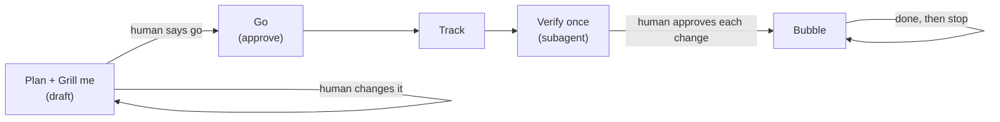

# 9. Planning flow

A plan passes five steps before the first bubble is built. The agent sharpens it at each step, and the human decides at each one: the agent only proposes.

## Plan + Grill me (draft)

The agent shows one short proposal: goal, guards and bubbles, each with its `[Boundary: …]`. Right after that it stores the proposal with `create <name> --draft`. Nothing on a draft is active: the gate blocks project edits, and `done` refuses. The human changes the plan as often as they want, and each change is one CLI command on the draft. If the human says "grill me", the agent questions the plan, one question per message. It changes the draft only when the human agrees.

## Go (approve)

The human says go to the draft as it stands. Only then does the agent run `approve`. A question, a change or the end of a grill is not a go.

## Track

`approve` turns the draft into a normal track. It is linear from S to F: one bubble per job, and no nesting. Fog stays fog until the human fills it.

## Verify once (subagent)

Right after `approve`, the agent runs `verify`. The command prints a workflow and the whole track. A subagent that never saw the chat reads this output, as the builder later will. It reports gaps: a vague boundary, a missing guard, a bubble to split, a result with no named structure, a hint that needs the chat. Each gap comes with the commands that close it. The agent applies none of them: the human approves each one. `verify` runs again only when the human asks.

## Bubble

The agent builds the active bubble inside its boundary, then runs `done` and stops. The human reviews the result and can change the rest of the track before they say go for the next bubble.
